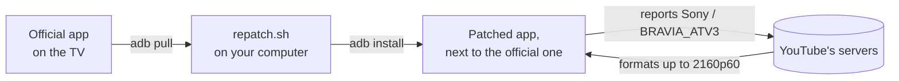

<div align="center">

# YouTube 4K60 on the Philips 49PUS7101

**Unlocks 2160p60 in YouTube on the Philips 49PUS7101 Android TV, without root.**


</div>

> [!NOTE]
> Built for one TV, the Philips 49PUS7101/12 (QM163E) on its final firmware, and tested only there.

## The problem

On this TV the official YouTube app caps every 60fps video at 720p30. Its quality menu says `Max 720p`, although the panel is 4K and the TV's chip decodes 4K60 VP9 in real time.

The cap comes from YouTube's servers, not from the TV. YouTube picks the formats it sends by the device the app reports, and for `PHILIPS` / `QM163E` it serves 60fps videos as 30fps formats, topping out at 720p. Changing one letter of the reported model, from `QM163E` to `QM163X`, was enough to get a 4K60 video to 3840x2160.

## What it does

`repatch.sh` builds a patched copy of the YouTube app that is already on your TV and installs it next to the official app, which stays untouched.

- The patched app reports a device that YouTube serves 60fps formats to, a Sony BRAVIA, so the servers send formats up to 2160p60.
- It widens the app's own codec limits, so it accepts those formats once they arrive.
- The device it reports is compiled into the app. Nothing has to be set again after the TV reboots.
- It needs no root, and none exists for this TV's Android 8 firmware.
- This repository holds no YouTube code. The script pulls the app from your own TV and patches it on your computer.



| | Official app | Patched app |
|---|---|---|
| Device it reports | `PHILIPS` / `QM163E` | `Sony` / `BRAVIA_ATV3` / `mt5895` |
| 60fps videos | `Max 720p`, played at 720p30 | up to 2160p60 |

With the patched app, the quality menu offers 2160p60, 1440p60, 1080p60 and 720p60. Stats for nerds shows itag 315 (VP9 2160p60) at 3840x2160@60, with 589 of 12,945 frames dropped (4.5%).

## Requirements

- A Philips 49PUS7101/12 with the official YouTube app, which comes installed on the TV
- adb access to the TV over your network
- `apktool`, a JDK for `jarsigner` and `keytool`, `adb`, and Python 3 with Pillow

## Build and install

```sh
git clone https://github.com/chillibytes/Philips_QM163E_YouTube.git
cd Philips_QM163E_YouTube
adb connect <tv-ip>:5555
./repatch.sh
```

The script pulls the official app from the TV, patches it, builds and signs the APK, and installs it. The first run also creates your own signing key in `keystore/`.

Open the patched app from the TV's launcher. Its icon has a black plate, so you can tell the two apps apart. Sign in with **Get started > Sign in with your phone**, which gives you a code to enter at yt.be/activate. Premium and multiple accounts work.

| Option | Effect |
|---|---|
| `--no-install` | Build only. The APK stays in `build/`. |
| `--keep` | Keep the decoded app in `build/` for inspection. |

### Updating

Play never updates the patched app, because it has its own package name. When the official app updates, run `./repatch.sh` again. It always patches the version that is on the TV now.

Keep `keystore/`. Only a build signed with the same key can upgrade the installed app in place. With a new key you'd have to uninstall it and sign in again.

## Status and limits

- Tested on one TV, a 49PUS7101/12 on firmware QM163E.0.26.70.1 (the final one for this chassis), with YouTube 5.30.320, built from macOS.
- Every patch checks that it applied, and the ones aimed at obfuscated code find their target by its shape. If a YouTube update moves something, the build stops with an error instead of producing a broken app.
- About 4.5% of frames drop at 2160p60, probably because Android's display plane on this TV runs at 1920x1080 and 50 Hz. Playback looks smooth.
- You can only sign in with a code from your phone. Google Play services refuses a re-signed app, so signing in on the TV itself doesn't work.
- Only the launcher icon changes. The logos inside the app come from a web app that YouTube streams at runtime.
- The reported device is set in `IDENTITY` in `patches/apply.py`. Changing it means rebuilding.
- A modified client is against YouTube's Terms of Service. Use it on your own TV, with your own account.

## How it works

[FINDINGS.md](FINDINGS.md) has the investigation: how the cap was traced to YouTube's servers, the dead ends ruled out on the way, and how each patch works, including how the reported device is written into the ARM code of `libcobalt.so`.

## License

[MIT](LICENSE)

## Disclaimer

This project is not affiliated with Google, YouTube, Philips, TP Vision or Sony. YouTube, Philips and BRAVIA are trademarks of their respective owners.
